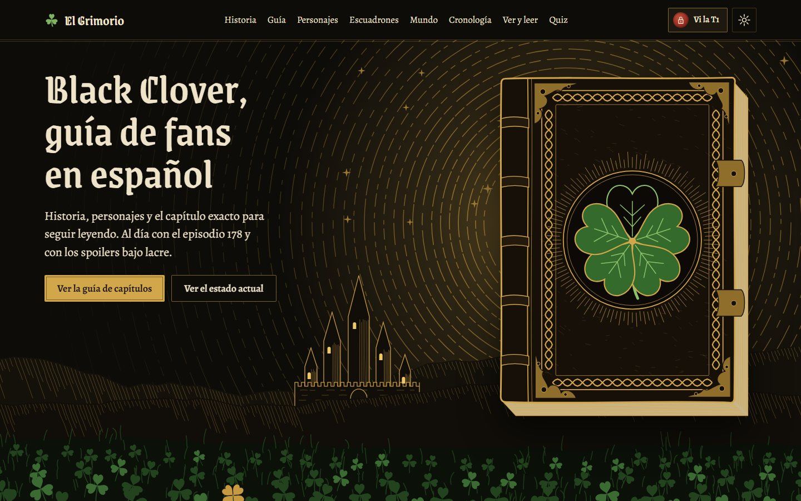
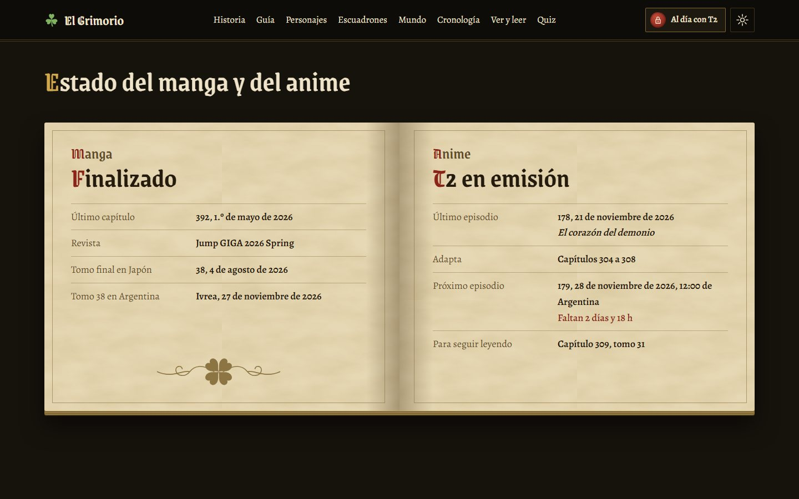
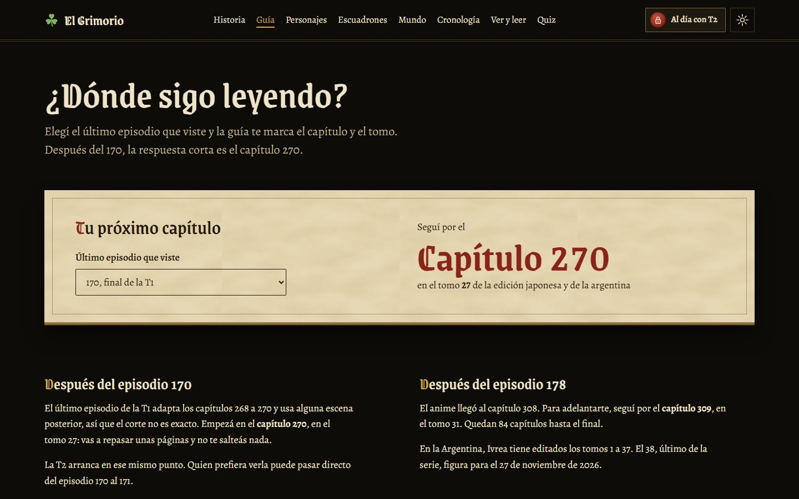
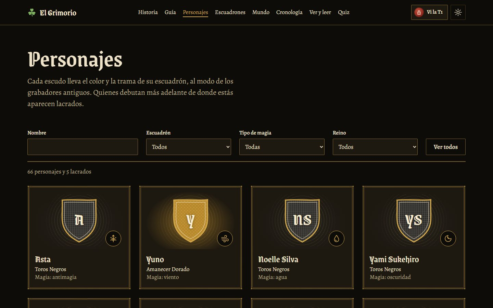
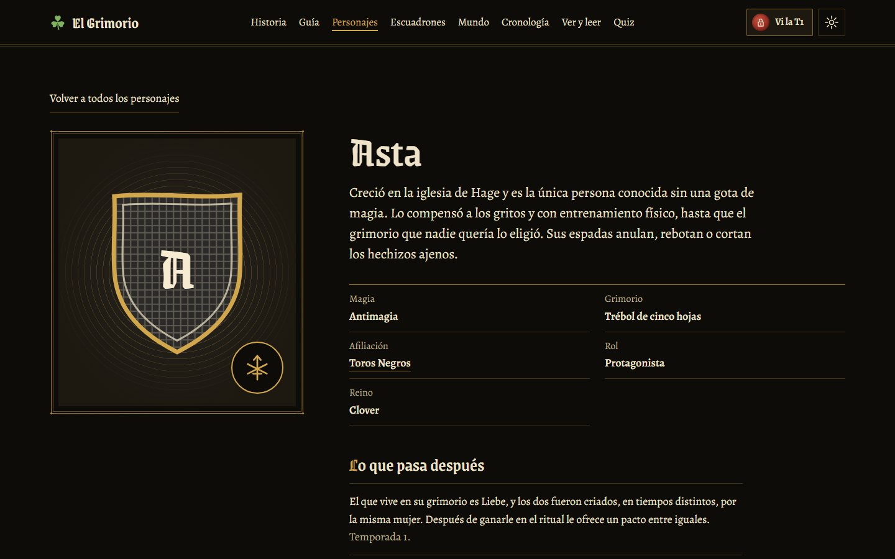
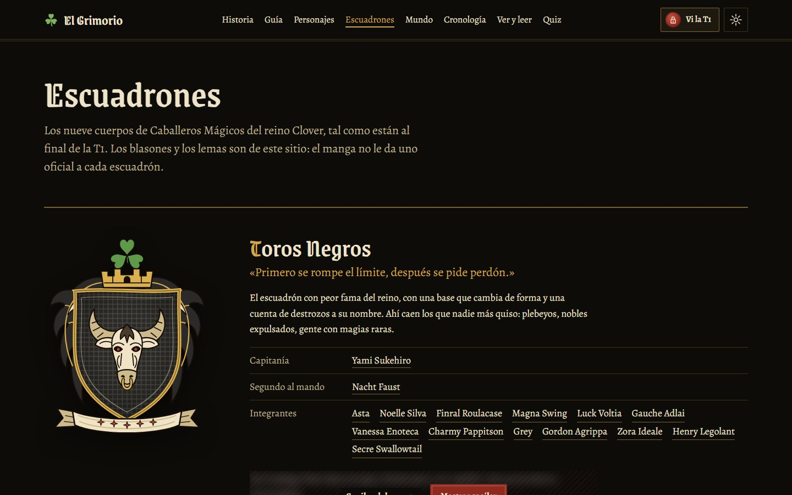
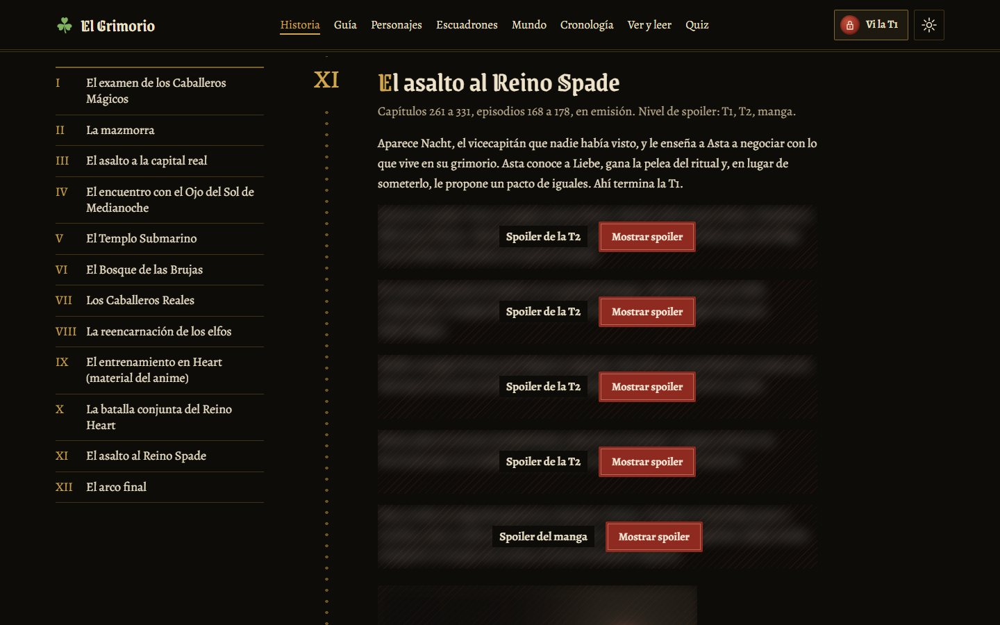
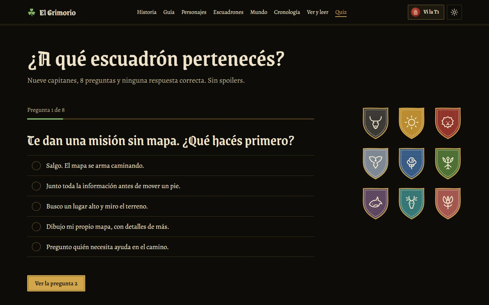
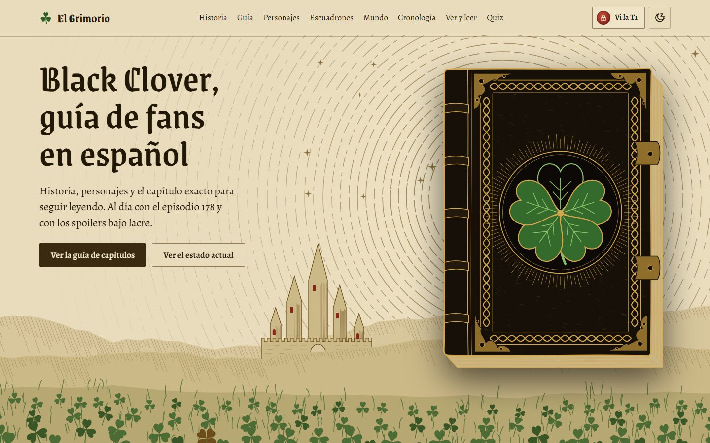
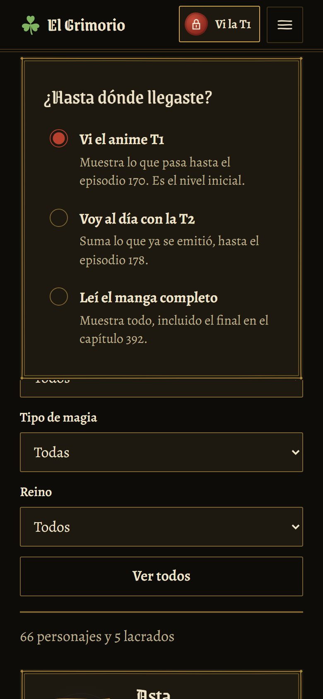

# El Grimorio de Clover

Sitio de fans de **Black Clover** en español, con guía de capítulos y un sistema anti-spoilers.

**Demo: https://stikyu.github.io/black-clover-fan/**



Proyecto sin fines de lucro, no afiliado a Shueisha, Studio Pierrot ni Crunchyroll. Black Clover es obra de Yūki Tabata. Los textos y los dibujos son propios: no hay páginas del manga, capturas del anime, logos ni ilustraciones oficiales.

## Qué tiene

- **Anti-spoilers en todas las páginas.** Tres niveles: "Vi el anime T1", "Voy al día con la T2" y "Leí el manga completo". Lo que falta ver queda difuminado con un botón "Mostrar spoiler", fuera del alcance del teclado, del lector de pantalla y de Ctrl+F. La elección se guarda en el navegador.
- **Estado actual:** manga, último episodio, próximo episodio con cuenta regresiva y capítulo para seguir.
- **Historia** en doce arcos, con rango de capítulos y episodios.
- **¿Dónde sigo leyendo?** Calculadora y tabla de episodios de la T2 con los capítulos que adaptan.
- **71 personajes** con buscador y filtros por escuadrón, tipo de magia y reino, y una ficha para cada uno.
- **Los nueve escuadrones** y los Reyes Magos.
- **Magia y mundo, cronología, dónde ver y leer** legalmente en Argentina y Latinoamérica.
- **Quiz:** ¿a qué escuadrón pertenecés?
- Responsive, oscuro por defecto con tema pergamino opcional, accesible, con sitemap y Open Graph.

| | |
|---|---|
|  |  |
|  |  |
|  |  |
|  |  |

<p>
  
  
</p>

## Actualizar cuando sale un episodio

Se edita **un solo archivo**: [`src/data/anime.json`](src/data/anime.json).

1. Cambiá `"ultimoEmitido"` por el número del episodio nuevo (por ejemplo, `179`).
2. En la entrada de ese episodio completá `"titulo"` (el de Crunchyroll en español) y `"capitulos"` con el primero y el último que adapta: `[309, 312]`.
3. Si ya se conoce el siguiente, completale el título. Si la lista se termina, agregá otra entrada.
4. Poné la fecha de hoy en `"actualizado"`.
5. `git commit -am "Episodio 179"` y `git push`. GitHub Actions compila, prueba y publica en unos minutos.

```json
"ultimoEmitido": 179,
...
{ "numero": 179, "enTemporada": 9, "titulo": "Yuno Grinberryall", "fecha": "2026-11-28", "capitulos": [309, 312] },
```

(Los capítulos de este ejemplo son inventados: hay que verificarlos cuando se emita.)

Con eso se actualizan solos el panel de la portada, la cuenta regresiva, la guía, la tabla, el arco en emisión y **todos los niveles de spoiler**: cada dato guarda el capítulo en el que se revela, así que lo que se acaba de animar deja de contar como spoiler del manga. Si falta el título o los capítulos, la compilación falla y avisa cuál.

También se puede hacer desde la web de GitHub, con el lápiz de edición del archivo.

Otros datos que cambian cada tanto:

| Qué | Archivo |
|---|---|
| Tomos y ediciones en español | `src/data/manga.json` |
| Dónde ver y leer | `src/data/donde-ver.json` |
| Hitos de la franquicia | `src/data/linea-de-tiempo.json` |
| Personajes y sus revelaciones | `src/data/personajes.json` |
| Escuadrones, arcos, mundo, quiz | `src/data/*.json` |

De dónde sale cada dato: [`docs/fuentes.md`](docs/fuentes.md). Por qué se hizo así: [`docs/decisiones.md`](docs/decisiones.md).

## Stack

Astro 7 y TypeScript, sitio estático. Interactividad con scripts propios sin frameworks. Colecciones de contenido con esquema. Dibujos en SVG generados al compilar. Pruebas con Playwright y axe. Deploy en GitHub Pages con GitHub Actions.

## Cómo correrlo

Necesitás Node 22.12 o más nuevo.

```bash
npm install
npm run dev        # http://localhost:4321/black-clover-fan/
npm run build      # revisa tipos y compila en dist/
npx playwright install chromium   # una sola vez, para las pruebas
npm run revisar    # compila en la raíz y corre las pruebas
npm run capturas   # regenera las capturas del README (después de revisar)
```

## Estructura

```
src/data/         datos en JSON
src/lib/          estado de la franquicia, niveles de spoiler y herramientas de grabado
src/components/   grimorio, paisaje, escudos, glifos y bloque de spoiler
src/pages/        una página por sección, más una por personaje
src/scripts/      selector de spoilers, menú y tema
tests/            spoilers, filtros, quiz, enlaces y accesibilidad
docs/             fuentes, decisiones y capturas
```

¿Viste un error o un dato desactualizado? [Abrí un issue](https://github.com/Stikyu/black-clover-fan/issues).
